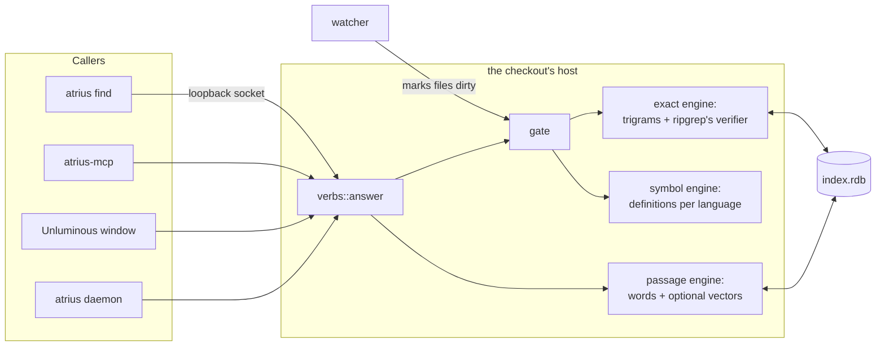
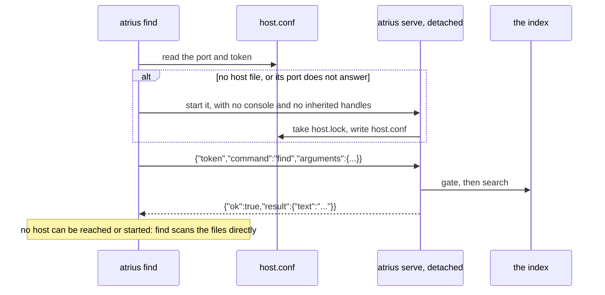
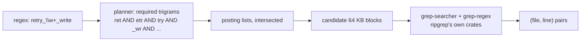
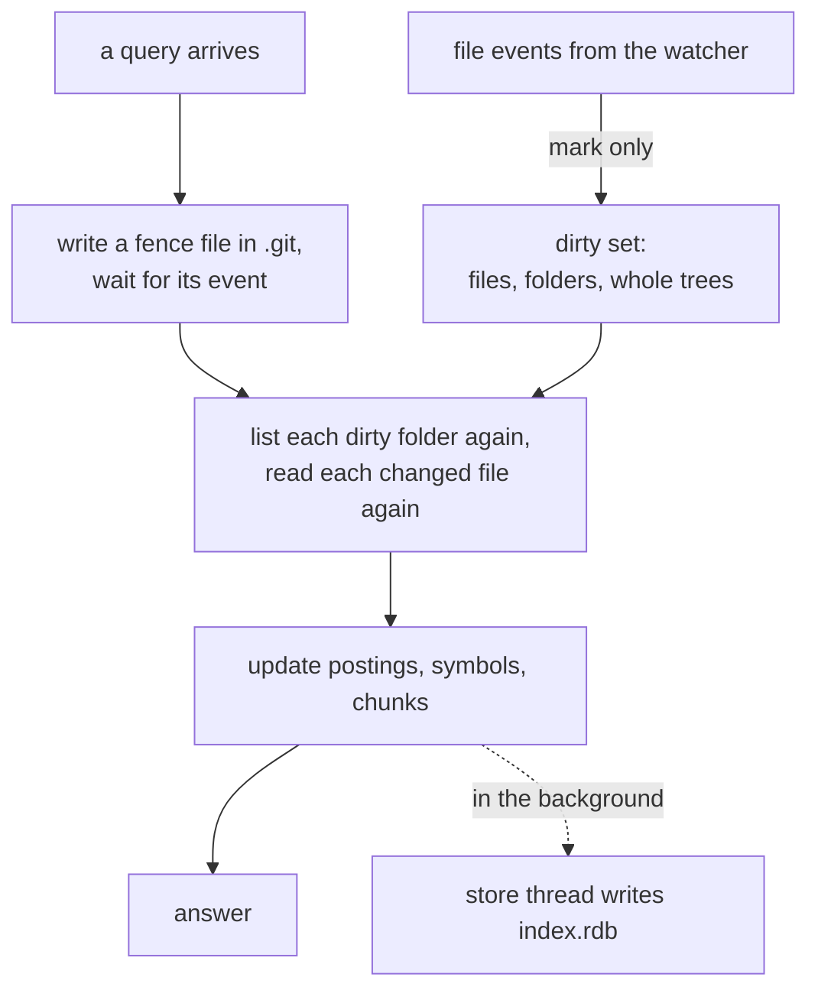

# Architecture

This page explains how Atrius answers a query: which process owns a checkout's index, the three engines
inside it, how the index stays current as files change, the file it is kept in, and the protocol
between a caller and the host. Terms are in the [glossary](glossary.md).

| Term | Meaning |
|---|---|
| Host | The one process that owns a checkout's index and answers its queries |
| Gate | The check before every query that reads any changed file in the query's scope again |
| Fence | An empty file the gate writes and waits to hear about, to know every earlier change has been heard |
| Trigram | Three consecutive bytes. The exact engine's index is a list of places for each trigram |

## The pieces



## One host per checkout

Inillucent lets several processes open one file, but a reader waits while a writer works, and two
watchers on one tree would repeat each other's work. So exactly one process owns a checkout's index.
Whichever process takes `host.lock` in the index folder first is the host. It writes `host.conf` with
its process id, a loopback port and a token, and every other caller sends its queries there.



A caller that lives as long as someone is working hosts in its own process: the MCP server, an editor
window, the background service. A one off command starts a detached `atrius serve`, because a host
started inside the command would be thrown away when it printed. The detached host stops after two
hours with no query.

When no host can be reached or started, `find` is still answered, by scanning the files with the same
code, and the reply says `"index":"none"`. The other queries need the index and are refused with
`not-running`.

**Why a detached host keeps no handles.** Windows gives a new process every inheritable handle its
parent holds. A command run from a shell writes to a pipe the shell waits on, and a host that inherited
it would hold it open for as long as it ran, so the command would look as if it never finished. Before
starting a host, the caller marks its standard handles as not inheritable. On Unix the host starts its
own session, so closing the terminal does not stop it.

## The three engines

### Exact: ripgrep's lines from an index



1. **The file set is the Grep tool's.** Atrius walks the checkout with the `ignore` crate, which is
   ripgrep's walker, with hidden files included and `.git`, `.svn`, `.hg`, `.bzr`, `.jj` and `.sl`
   left out. These are the flags Claude Code's Grep tool passes to ripgrep.
2. **Every file is cut into 64 KB blocks**, and every trigram of each block, folded to lower case, is
   added to that trigram's posting list. A file with a UTF-16 byte order mark is indexed as the text it
   decodes to, as ripgrep searches it.
3. **A query becomes a trigram plan.** The regex is parsed with `regex-syntax`, ripgrep's parser, into
   the trigrams any match must hold: an AND of the literal parts and an OR across alternatives. A
   pattern with no usable trigrams, such as `\w+`, checks every block in scope.
4. **The candidates are verified** with `grep-searcher` and `grep-regex`, the crates ripgrep is built
   from, so binary detection, line endings, case folding and the regex engine are ripgrep's own. That
   is why the answer equals ripgrep's by construction.

### Symbols: definitions without a parser

Each language's manifest names the keywords that introduce a definition, and the C family names a rule
for functions with no keyword. One tokeniser pass finds the definitions; brackets or indentation find
where each one ends. `def` ranks exact spellings first, sure definitions before likely ones, and the
project's source before tests, examples and documentation. `outline` and `fragment` read the same
definitions. [Languages](languages.md) has the details.

### Passages: questions in plain English

Each file is cut into chunks, one per definition where a language is known and by heading or size
otherwise. The chunks go into an Inillucent `inillucent_search` table with these columns:

| Column | Holds |
|---|---|
| `header` | the chunk's signature line and path |
| `body` | the chunk's text |
| `words` | identifiers split into their parts: `retryFailedWrite` adds `retry failed write` |
| `lang`, `kind`, `path_prefix` | facets: the language, code or document, and the top folder |
| `vector` | a 768 number embedding from nomic-embed-text, when a model is installed |

A question is ranked by BM25 over the words, fused with vector similarity when there are vectors, with
code ranked before documents. When too few of the question's words appear in the best chunk, the
answer is that nothing matches. That cutoff was chosen by measurement; see [Lab findings](lab/findings.md).

## Staying current



- **Events are hints.** An event marks a file or folder dirty and nothing more. A folder created,
  renamed or removed marks its whole tree. A watcher buffer overflow marks everything.
- **The gate makes a query fresh.** Before a query reads the index, every dirty folder is listed again
  with the same walk, and every file whose size, time or content changed is read again. A file an agent
  wrote a moment ago is searched as it now is.
- **The fence closes the last gap.** The operating system queues an event when a write finishes, and
  the watcher's thread reads it a little later. The gate writes an empty fence file and waits up to
  250 ms for its event. Events arrive in order, so once the fence's event arrives, every earlier event
  has too. The fence goes inside `.git`, where git ignores unknown files and the index never looks.
- **A branch switch or a burst of thousands of files** marks whole trees, and the gate reconciles them.
  The [freshness test](testing.md) changes a checkout in seven ways and checks every answer against
  ripgrep with no pause.
- **When the watcher cannot start**, the whole tree is marked dirty, so every query reconciles by size
  and time. Answers stay correct and only speed suffers. `atrius doctor` reports this.

Writing to the index file happens on a store thread of its own, after the answer, so a query never
waits on the disk. A host that starts with an existing index file loads it and reconciles the whole
tree once in the background, because files may have changed while no host was running.

## The index file

`index.rdb` is an Inillucent database in the cache folder:

| Table | Holds |
|---|---|
| `meta` | the schema and trigram versions, and what the passage table was built with |
| `file` | one row per file: path, language, size, time, content hash, line count |
| `blob` | each file's bytes, compressed with lz4, by content hash |
| `trigram` | each trigram's posting list, compressed |
| `trigram_delta` | changes since the posting lists were last compacted |
| `passage` | the `inillucent_search` table of chunks |

A change in the schema version or the trigram version makes the next host build the index again.

## The wire protocol

One JSON object a line, one request a connection, on `127.0.0.1` at the port in `host.conf`:

```text
request  {"token":"<32 hex>","command":"find","arguments":{"query":"retry"}}
reply    {"ok":true,"command":"find","result":{"text":"...", ...}}
refusal  {"ok":false,"command":"find","error":{"code":"usage","message":"..."}}
```

| Code | Meaning |
|---|---|
| `usage` | the arguments were wrong |
| `unknown-command` | there is no such command |
| `not-found` | a folder, file or line that is not there |
| `not-running` | no host could be reached or started, and the command needs one |
| `refused` | the token did not match |
| `failed` | it was tried and did not work |
| `timed-out` | it was still going when the time ran out |

Besides the seven queries, a host answers `serve` (already running), `stop` and `status` with its own
process and port. A command may carry the prefix `search.`, which is how Unluminous names the same
commands.

## Security

| Concern | What stops it |
|---|---|
| Another user on the machine queries your index | The port is loopback only, and a request without the token in `host.conf` is refused. `host.conf` is in your own cache folder |
| A query reads outside the checkout | Every answer comes from the file set under the root, so `--path ../` or `--path C:/Windows` matches nothing |
| Two hosts write one index | `host.lock` is exclusive: opened with no sharing on Windows, `flock` on Unix |
| A host crashed and left `host.conf` | A caller tries the port; when it does not answer, the caller starts a new host, which takes the now free lock |
