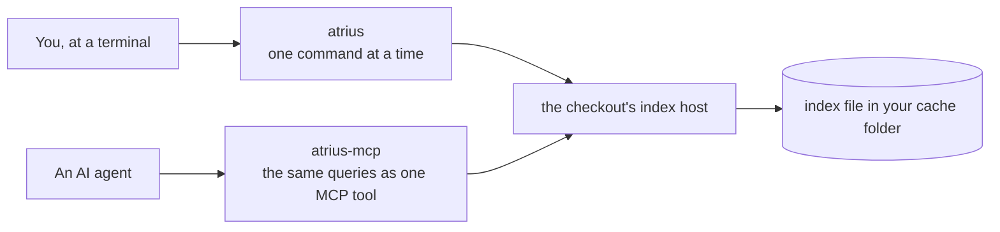

# Getting started

This page shows how to install Atrius, run a first search, connect an agent, and read what the programs
print when something fails. Terms such as host and checkout are in the [glossary](glossary.md).

## Install

On Windows, in PowerShell:

```powershell
irm https://blackrainbowlabs.com/downloads/atrius-index/install.ps1 | iex
```

On macOS and Linux:

```sh
curl -fsSL https://blackrainbowlabs.com/downloads/atrius-index/install.sh | sh
```

| Script | Installs into | Puts the programs on your path by |
|---|---|---|
| `install.ps1` | `%LOCALAPPDATA%\Programs\atrius-index` | adding its `bin` folder to your user `Path` |
| `install.sh` | `~/.local/share/atrius-index` | linking `atrius` and `atrius-mcp` into `~/.local/bin` |

Both scripts download the archive for your machine, check it against the release's published
`SHA256SUMS`, and need no administrator rights. Both take `--version` (`-Version` on Windows) to
install a specific release and `--uninstall` (`-Uninstall`) to remove it.

### Package managers

| Manager | Command |
|---|---|
| Homebrew, macOS and Linux | `brew install black-rainbow-labs/atrius/atrius-index` |
| cargo, any platform with Rust | `cargo install atrius-cli` |
| Debian and Ubuntu | download `atrius-index_<version>_amd64.deb` (or `arm64`) and run `sudo apt install ./atrius-index_<version>_amd64.deb` |
| Fedora, RHEL and openSUSE | download `atrius-index-<version>.x86_64.rpm` (or `aarch64`) and run `sudo dnf install ./atrius-index-<version>.x86_64.rpm` |
| macOS installer | `atrius-index-<version>.pkg`, signed with an Apple Developer ID and notarized by Apple |

Every download is at [blackrainbowlabs.com/downloads/atrius-index](https://blackrainbowlabs.com/downloads/atrius-index/).
To check one by hand:

```sh
minisign -Vm SHA256SUMS -p atrius-index.pub     # the key is beside the downloads
sha256sum -c SHA256SUMS --ignore-missing
```

## The two programs



`atrius` and `atrius-mcp` answer every query through the same function, so they print the same text.

## A first search

From inside any git checkout:

```sh
atrius find TODO
atrius def main
atrius status
```

The first query starts an index host for the checkout and answers by scanning the files while the index
builds. `status` says `ready` once it is built: 0.6 seconds for a repository of 2,000 files, 28 seconds
for Linux's 89,668. [Performance](performance.md) has the measurements. The host stays running for two hours after its last query, so
every later query is answered from memory.

## Connect an agent

Claude Code:

```sh
claude mcp add atrius -- atrius-mcp
```

[MCP](mcp.md) has the lines for Cursor, VS Code, Codex and other clients, and the text an agent sees.

## Keep a checkout indexed all the time

```sh
atrius watch add ~/code/my-project
atrius service install
```

The service starts at every login and keeps each watched checkout's index current, so the first
query of the day is answered at once. [The background service](service.md) explains each platform.

## When something fails

| Exit code | Meaning | Example |
|---|---|---|
| 0 | The command was carried out | `atrius find retry` printed its lines, or printed nothing because nothing matched |
| 1 | The command was refused | `atrius outline missing.rs` prints `not-found: ...` on standard error |
| 2 | The command line was wrong | `atrius find` with no query prints the usage line |

`--json` prints the whole reply, including a refusal's `code` and `message`:

```sh
atrius outline missing.rs --json
```

```json
{ "ok": false, "command": "outline", "error": { "code": "not-found", "message": "..." } }
```

`atrius doctor` checks the machine: that the cache folder can be written, that file change events arrive,
the inotify limit on Linux, and whether an embedding model is installed.

## Where to go next

- [Command reference](commands.md) for every flag.
- [Architecture](architecture.md) for how it works.
