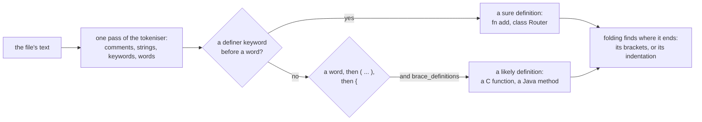

# Languages

Atrius searches every text file exactly, in any language. A language also needs a manifest for `def`,
`outline`, `fragment` and plain English search to know where its definitions are. This page lists the
24 languages compiled in, explains the manifest format, and shows how to add a language.

```sh
atrius languages
```

## The bundled languages

| Language | Extensions | Definitions come from |
|---|---|---|
| C | `.c` `.h` | `struct`, `enum`, `union`, and a name followed by its parameters and a `{` on the same line or the next |
| C++ | `.cpp` `.cc` `.cxx` `.hpp` `.hh` `.hxx` and others | `class`, `struct`, `enum`, `union`, `namespace`, `concept`, and functions as in C, with `const`, `override` and other words allowed before the `{` |
| C# | `.cs` `.csx` | `class`, `struct`, `interface`, `enum`, `record`, `namespace`, and methods as in C |
| CSS | `.css` | none |
| Go | `.go` | `func`, `type`, `const`, `var`, and methods with a receiver |
| HTML | `.html` `.htm` | none |
| Java | `.java` | `class`, `interface`, `enum`, `record`, and methods as in C, with a `throws` clause allowed |
| JavaScript | `.js` `.jsx` `.mjs` `.cjs` | `function`, `class`, `const`, `let`, `var`, and class methods |
| JSON | `.json` | none |
| Kotlin | `.kt` `.kts` | `fun`, `class`, `interface`, `object`, `typealias`, `val`, `var` |
| Lua | `.lua` | `function`, `local` |
| Mermaid | `.mmd` `.mermaid` | none |
| PHP | `.php` `.phtml` | `function`, `class`, `interface`, `trait`, `enum`, `namespace`, `const` |
| Python | `.py` `.pyw` | `def`, `class` |
| Ruby | `.rb` `.rake` `.gemspec` `.ru` | `def`, `class`, `module` |
| Rust | `.rs` | `fn`, `struct`, `enum`, `trait`, `mod`, `const`, `static`, `type`, `let` |
| Scala | `.scala` `.sc` | `def`, `class`, `object`, `trait`, `enum`, `type`, `val`, `var`, `given` |
| Shell | `.sh` `.bash` `.zsh` | a name followed by `()` and `{`, as in `deploy() {` |
| SQL | `.sql` `.ddl` `.dml` `.psql` | none |
| Swift | `.swift` | `func`, `class`, `struct`, `enum`, `protocol`, `actor`, `typealias`, `let`, `var` |
| TOML | `.toml` | none |
| TypeScript | `.ts` `.tsx` `.mts` `.cts` | as JavaScript, plus `interface`, `type`, `enum`, `namespace` |
| YAML | `.yml` `.yaml` | none |
| Zig | `.zig` `.zon` | `fn`, `const`, `var` |

Markdown has no manifest. Its headings are its outline and its sections are its chunks.

Each manifest's `plugin.limitations` line says what it misses, such as a Kotlin extension function
written `fun Type.name`, or a Ruby method written `def self.name`. Definitions found by the
parameter and brace rule are marked likely, and rank after the ones a keyword introduced.

The [corpus tests](testing.md) check hand picked definitions in 18 real repositories across these
languages.

## How a definition is found



There is no parser. A definition is a keyword the manifest names as a definer, followed by a name. A
language whose functions have no keyword, such as C or Java, turns on `language.brace_definitions`: a
name directly followed by its parameter list and an opening brace is then a likely definition. Where a
definition ends comes from its brackets, or from its indentation in Python, Ruby and other languages
without braces.

## The manifest format

A manifest is a `.conf` file of `name = value` lines. A `#` followed by a space and more text starts a
comment; a `#` that ends a line is part of the value, which is how a language whose comments start
with `#` writes `language.line_comment = #`.

```text
plugin.id          = go
plugin.name        = Go
plugin.limitations = A method with a receiver is found when its parameter list opens and closes on one line.

language.extensions    = .go
language.line_comment  = //
language.block_comment = /*, */
language.strings       = ", ', `
language.keywords      = break, case, chan, const, func, go, if, import, package, return, type, var
language.builtins      = append, len, make, new, panic, string, int, error

language.definers          = func=function, type=type, const=constant, var=variable
language.brace_definitions = true
language.definition_tail   = true
```

| Key | Meaning |
|---|---|
| `plugin.id` | The language's id, such as `go` |
| `plugin.name` | Its name, such as `Go` |
| `plugin.limitations` | What the manifest knowingly misses, in a sentence or two |
| `language.extensions` | The file extensions it claims, comma separated |
| `language.line_comment` | What starts a comment that runs to the end of the line |
| `language.block_comment` | The opening and closing marks of a block comment |
| `language.strings` | The quote characters, comma separated |
| `language.escapes` | Whether a backslash escapes the next character in a string; `true` by default |
| `language.keywords` | The reserved words. A keyword is never a definition's name or a call |
| `language.builtins` | Names the language provides. A builtin is never a definition |
| `language.types` | Names that are types even in lower case |
| `language.operators` | Characters that are operators |
| `language.word_characters` | Characters other than letters, digits and `_` that belong in a word, such as `-` in CSS |
| `language.definers` | `keyword=kind` pairs. The kinds are `function`, `type`, `constant`, `variable` and `module` |
| `language.brace_definitions` | `true` when a name followed by `( ... )` and `{` on the same line is a likely function |
| `language.brace_next_line` | `true` when that `{` may be on the next line, as in C, C# and Java written in Allman style |
| `language.definition_tail` | `true` when words may stand between the `)` and the `{`, such as `const`, `throws IOException` or `-> Int`, and when a space may stand between the name and its `(` |
| `language.export_keyword` | The word that makes a definition visible to other files, such as `export` or `pub` |
| `language.markup` | `true` for a markup language such as HTML |

The [structural keys](#the-structural-keys) below describe what a definition belongs to and what types it
has.

`language.brace_next_line` and `language.definition_tail` exist only in Atrius. The other keys are the
same as in Unluminous's language plugins, so a manifest written for one reads in the other.

## The structural keys

```text
language.containers = impl, trait, struct, enum, mod
language.records    = struct
language.enums      = enum
language.annotation = :
language.returns    = ->
language.visibility = pub=public, pub(crate)=crate, pub(super)=crate
language.kinds      = struct=struct, enum=enum, trait=trait, type=alias
language.members    = ., ::
```

Those lines are from `rust.conf`. Besides each definition's name and lines, Atrius reads what a definition
belongs to, what it takes and returns, what type a field or a variable has, who may use it, and the first
line of its documentation. There is still no parser. The reading uses the words, comments and strings the
tokeniser already finds, the definitions a definer keyword introduces, and the blocks folding finds from
brackets or indentation. The keys below tell it how a language writes those parts. Every key is optional.
A language that names none of them keeps its definitions with their names, kinds and lines, and the
definitions have no container, parameters or types.

| Key | Value | Meaning |
|---|---|---|
| `language.containers` | A comma list of words | The words a block's head line starts with when the block holds members, such as `impl, trait, struct, enum, mod` in Rust and `class, interface, enum, namespace` in TypeScript. The name on the head line is the container of every definition directly inside the block. `impl Trait for Type` names `Type`. A function inside a container that is not a module is a method. |
| `language.records` | A comma list of container words | The containers whose blocks list fields, one a line, as `name: Type`. Each such line is a definition of kind `field`. |
| `language.enums` | A comma list of container words | The containers whose blocks list variants, one a line. Each is a definition of kind `variant`. |
| `language.annotation` | One word | What stands between a name and its type: `:` in Rust, TypeScript and Python. The word `space` means the type follows the name after a space, as in Go. |
| `language.returns` | One word | What stands between a parameter list and its return type: `->` in Rust and Python, `:` in TypeScript. The word `space` means the type follows the parameter list after a space, as in Go. |
| `language.visibility` | `word=public`, `word=crate` or `word=private` pairs | The words that say who may use a definition. A word with no `=` means private, so `private, protected=crate` is TypeScript's list. |
| `language.kinds` | `keyword=kind` pairs | The finer kind a definer keyword makes, such as `struct=struct, enum=enum, trait=trait, type=alias`. A definer not named here keeps the kind `language.definers` gave it. |
| `language.members` | A comma list of operators | What reaches a member of a value or a module: `., ::` in Rust and `., ?.` in TypeScript. |
| `language.receivers` | `true` or `false` | `true` when a function's receiver is written in brackets before its name, as in Go's `func (s *Server) Start()`. The function is then a method of `Server`. |

Atrius refuses a manifest, with a message, in two cases. `language.visibility` holds a level other than
`public`, `crate` or `private`. `language.kinds` holds an entry with no `=`, or a kind that is not one of
the sixteen: `function`, `method`, `type`, `struct`, `enum`, `variant`, `trait`, `interface`, `class`,
`field`, `constant`, `variable`, `module`, `parameter`, `alias` and `macro`. A type alias has the kind
`alias`.

Go shows the two `space` values and the receiver key together:

```text
language.containers = type
language.records    = type
language.annotation = space
language.returns    = space
language.receivers  = true
language.kinds      = type=type
language.members    = .
```

A language whose `language.visibility` names no `public` word, such as TypeScript, treats a definition
inside a type as public unless a private word is on its line. A language that names a `public` word, such as
Rust, treats a definition as private unless that word is on its line or the export keyword marks it.

The 16 bundled languages that define symbols name these keys. TypeScript, Python and Go are the examples to
read after Rust.

### Imports

Atrius also reads each file's import statements into a list of paths. The keys that decide what an import
statement is are the older ones: `language.imports`, `language.import_keywords`, `language.import_extensions`,
`language.import_index`, `language.import_omit_extension` and `language.path_roots`. A path import such as
Rust's `use crate::layout::{Layout as L}` becomes the segments `crate`, `layout`, `Layout` with the alias
`L`. A quoted import such as `import { a } from './m'` becomes the specifier `./m` followed by `a`. A glob,
such as `import * as m from './m'`, is marked as a glob. The library gives each import
as an `Import` with `path`, `alias`, `glob` and `range`. See [Using the library](library.md).

### What a definition row holds

`def`, `outline` and `fragment` print these fields in their JSON rows when they are known. A field that was
not found is left out of the row.

| Field | Holds |
|---|---|
| `kind` | The family of the definition: `function`, `type`, `constant`, `variable`, `module`, `field` or `variant`. This is the field older rows had. |
| `symbolKind` | The finer kind, one of the sixteen above. Always present. |
| `visibility` | `public`, `crate` or `private`. Always present. |
| `container` | The type or module whose block holds the definition |
| `parameters` | A callable's parameters as text, such as `ui: &mut Ui, at: Pos2` |
| `returns` | A callable's return type as written |
| `typeText` | A field's or variable's type, as written or as its constructor names it |
| `doc` | The first line of the comment above the definition, or of a Python docstring under it |

`parameters` is present only for a function, a method or a macro. `fragment` puts these fields in a
`definition` object when the lines it returns are one short definition.

## Adding a language

Put a manifest in a folder and name the folder in `ATRIUS_LANGUAGES` before the host starts:

```sh
mkdir -p ~/.config/atrius-index/languages
cp elixir.conf ~/.config/atrius-index/languages/
export ATRIUS_LANGUAGES=~/.config/atrius-index/languages
atrius stop && atrius languages
```

A manifest in that folder claims its extensions from a bundled one, so it also replaces a bundled
language. A program that embeds the library adds one with `atrius_index::grammars::register`, as
[Using the library](library.md) shows.

To add a language to the bundled list, put its manifest in `crates/atrius-index/languages/`, add it to
`BUNDLED` in `crates/atrius-index/src/grammars.rs`, and add a corpus in that language to
`tests/corpora.json` with three hand checked definitions.
