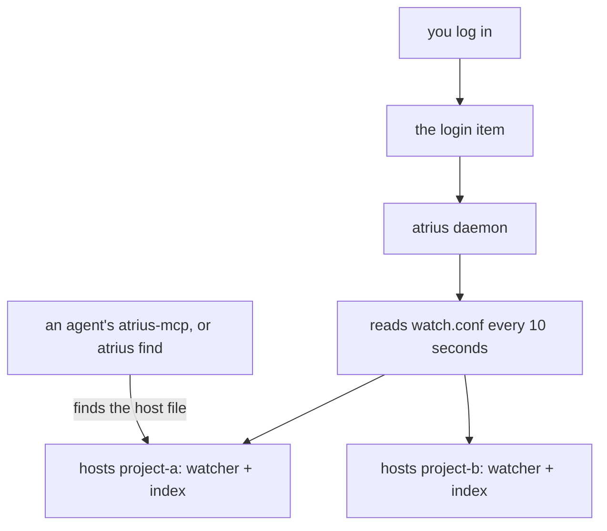

# The background service

A query starts an index host for its checkout when none is running, and the host stops after two hours
with no query. That is enough for most use. The background service is for checkouts that should be
indexed at all times, so the first query after a login, a reboot or a large `git pull` is answered at
once. This page explains the watch list, how the service is installed on each platform, and how
`atrius doctor` checks that file change events arrive.

## Turn it on

```sh
atrius watch add ~/code/project-a
atrius watch add ~/code/project-b
atrius service install
atrius service status
```

`service install` registers a login item for the current user and starts the service now. It needs no
administrator rights on any platform, and the service runs as you, so it can read your checkouts.

## What runs



`atrius daemon` hosts every folder on the watch list in one process and never stops on its own. A
folder added with `atrius watch add` is picked up within 10 seconds. A folder removed with `atrius watch
remove` is let go by restarting the daemon, because a host holds its folder's lock for the life of its
process. A folder another program already hosts, such as an open Unluminous window, is left to that
program and tried again on the next pass.

## Each platform

| Platform | Login item | Started now with | Removed by `service uninstall` |
|---|---|---|---|
| Windows | the value `AtriusIndex` under `HKCU\Software\Microsoft\Windows\CurrentVersion\Run`, running `conhost.exe --headless atrius.exe daemon` so no console window opens | a detached `atrius daemon` | deleting the value and stopping the daemon |
| macOS | `~/Library/LaunchAgents/com.blackrainbowlabs.atrius-index.plist`, with `KeepAlive` on failure and low priority input and output | `launchctl bootstrap gui/<uid>` | `launchctl bootout` and deleting the file |
| Linux with systemd | `~/.config/systemd/user/atrius-index.service`, with `Nice=10` and idle input and output priority | `systemctl --user enable --now atrius-index.service` | `systemctl --user disable --now` and deleting the file |
| Linux without systemd | `~/.config/autostart/atrius-index.desktop` | a detached `atrius daemon` | deleting the file and stopping the daemon |

The daemon writes its process id to `daemon.pid` in the [configuration folder](configuration.md).
`service status` reports whether the login item exists and whether that process is running.

## The watch list

`watch.conf` in the configuration folder holds one absolute folder a line. Lines starting with `#` are
comments. It can be edited by hand; the daemon reads it again within 10 seconds.

```text
# The folders `atrius daemon` keeps indexed, one a line.
/home/me/code/project-a
/home/me/code/project-b
```

## Checking the machine

```sh
atrius doctor
```

```text
ok   cache folder: /home/me/.cache/atrius-index
ok   file events: an event arrived 3 ms after a write in a subfolder
ok   inotify watches: 4120 directories in the watched folders, limit 65536
ok   embeddings: no embedding model is installed. Plain English search ranks by words alone.
ok   background service: login item: installed; daemon: running, process 4182; watched folders: 2
```

**File events.** A watcher that delivers nothing looks exactly like a checkout nobody is editing, so
`doctor` writes a file in a scratch folder and waits up to five seconds for the event. When no event
arrives, answers stay correct: every query first compares the size and time of each file in its scope
with what the index holds. Only the speed of a large checkout suffers.

**The inotify limit on Linux.** inotify needs one watch for every directory, and when
`fs.inotify.max_user_watches` is reached, new directories are not watched and nothing says so.
`doctor` counts the directories in the watched folders and fails when they come within half of the
limit. It prints the lines that raise the limit:

```sh
echo fs.inotify.max_user_watches=524288 | sudo tee /etc/sysctl.d/60-atrius.conf
sudo sysctl --system
```

macOS FSEvents and Windows ReadDirectoryChangesW watch a whole tree with one handle and have no such
limit.

## Turning it off

```sh
atrius service uninstall
```

The indexes stay in the cache folder, and the next query loads them.
