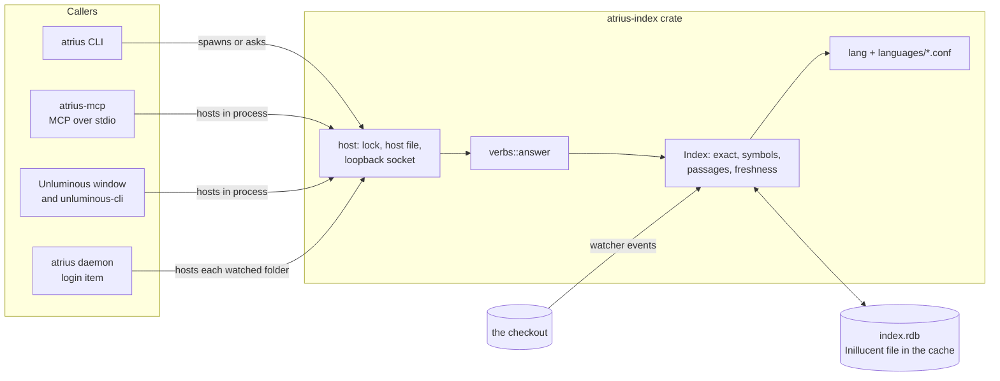
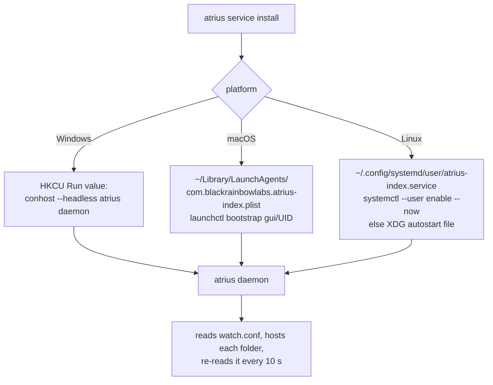
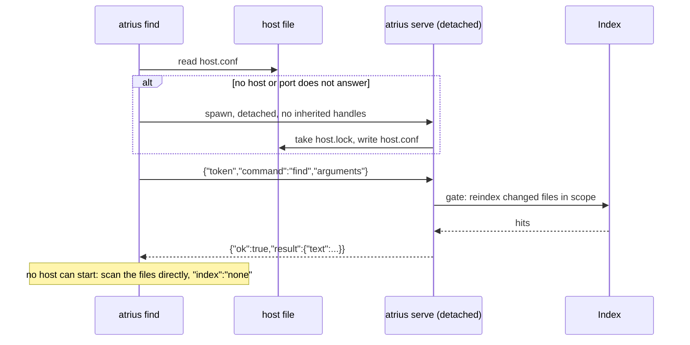

# task-2172: atrius-index, the code index as its own product

## Introduction

task-2139 built a code index inside Unluminous: a trigram index that returns exactly ripgrep's lines
27 to 136 times faster, symbol lookup, function fragments, file outlines and plain English passage
search, kept fresh by a file watcher. It ships only as the `search` area of `unluminous-cli` and the
`unluminous_search` MCP tool, so it can only be used by someone who installs an editor.

This ticket moves the index into its own private repository, `Black-Rainbow-Labs/atrius-index`, as a
product called **Atrius**. It gets its own command line program (`atrius`), its own MCP server
(`atrius-mcp`), a background service for Windows, macOS and Linux, release archives and installers in
the same form as Inillucent's, a Homebrew tap, documentation in the Inillucent format, a lab page on
blackrainbowlabs.com, and a test suite run against real open source code bases in many languages.
Unluminous then depends on the `atrius-index` crate instead of its own copy.

| Term | Meaning on this page |
|---|---|
| host | The one process per checkout that owns the index file, runs the watcher and answers queries |
| checkout | A folder being searched, normally a git working tree |
| verb | One query kind: `find`, `def`, `refs`, `fragment`, `outline`, `files`, `status` |
| corpus | A real open source repository, pinned to a commit, that the tests search |
| parity | The index returns the same set of `(path, line)` pairs as ripgrep for the same query |

## Goals and non goals

### Goals

| # | Goal | How it is checked |
|---|---|---|
| G1 | A private repository `Black-Rainbow-Labs/atrius-index` holds the engine, the CLI, the MCP server, docs, tests and release tooling | `gh repo view` reports it private |
| G2 | `atrius` and `atrius-mcp` answer every verb through one function, so the CLI and MCP give the same text | A test runs every verb through both and compares the text |
| G3 | The engine has no dependency on Unluminous | `cargo tree -p atrius-index` names no `unluminous` crate |
| G4 | Exact search equals ripgrep on real code | Parity on 16 pinned corpora in 12 languages, from 30 files to 89,000 files, every query |
| G5 | `def` finds definitions in every bundled language | Each corpus has hand checked definitions that must be found at rank 1 to 3 |
| G6 | The index stays fresh | After a create, edit, rename, delete, a 2,000 file burst and a branch switch, every query equals ripgrep |
| G7 | It installs on Windows, macOS and Linux | Archives for five targets, `install.sh`, `install.ps1`, a Homebrew formula, `.deb`, `.rpm`, a signed and notarized macOS `.pkg`, and `cargo install atrius-cli`, each installed and run once |
| G8 | A background service keeps chosen checkouts indexed | `atrius service install` registers a per user login item on each platform, `atrius doctor` checks the watcher |
| G9 | Unluminous uses Atrius | `unluminous-index` is removed from the Unluminous workspace, its `search` area calls `atrius_index`, and its test suite passes; Unluminous is released |
| G10 | Documentation and a lab page | `docs/` in the Inillucent format including a lab findings page, and `blackrainbowlabs.com/lab` live |

### Non goals

- No change to ranking, chunking or fusion. The task-2139 numbers describe this engine, and changing
  it would make them describe something else. Improvements are recommended in the findings document.
- No public source mirror. Source is private; binaries and the crates.io packages are public.
- No new embedding model. `embed()` stays optional and nothing is downloaded at run time.
- No Windows MSI. Inillucent decided against it for a command line program, for the same reasons.

## Problem statement

- The index can only be used through Unluminous. A developer who wants faster, more accurate search
  for an agent has to install an editor to get it.
- The index crate reaches into the editor: it `include_str!`s the editor's plugin manifests from
  `crates/unluminous-app/plugins/` and imports four modules from `unluminous-core`. It cannot be built
  outside the Unluminous workspace.
- It knows twelve languages, chosen for the editor. Of the languages agents work in most, Go, Java,
  C, C++, C#, Ruby, PHP, Kotlin and Swift have no definitions, so `def`, `outline` and `fragment`
  answer only by text for them.
- Its tests ran on four corpora, three of them our own repositories. Nothing shows it works on code
  written by other people in other languages.
- A host exists only while some caller keeps it alive. There is no way to keep a large checkout indexed
  ahead of the first query, and nothing checks that the platform's file watcher actually delivers
  events (Linux's inotify watch limit fails quietly).

## Architectural overview



The host protocol, the index folder layout and the lock are shared by every caller. A checkout has one
host whether the first caller was an agent, a terminal or the editor, and every later caller asks it.

## Components and interfaces

### Repository layout

```
atrius-index/
  crates/atrius-index/        library: engine, languages, host, protocol, verbs
    languages/*.conf          24 language manifests compiled in
  crates/atrius-cli/          binaries `atrius` and `atrius-mcp`
    src/catalogue.rs          one table of commands: CLI help, MCP schema and docs/commands.md
  tests/corpora.toml          pinned real world repositories
  tests/                      corpus, CLI, MCP, freshness and service tests
  docs/                       Inillucent format pages, including docs/lab/findings.md
  packaging/                  ship.ps1, install.sh, install.ps1, homebrew, linux, macos
  tools/cargo.ps1             cargo with the MSVC environment
```

### The library, `atrius-index`

The engine modules move unchanged except for names. What changes:

| Module | Change |
|---|---|
| `lang/` (new) | `manifest`, `syntax`, `symbols`, `folding` copied from `unluminous-core`; two new grammar keys, `language.brace_next_line` and `language.definition_tail`, so a C, Java or C# method whose brace is on the next line, or follows `const` or `throws`, is a definition. The JavaScript rule is unchanged when the keys are absent |
| `grammars` | Manifests come from `languages/*.conf`, 12 copied from Unluminous and 12 new: C, C++, C#, Go, Java, Kotlin, Lua, PHP, Ruby, Scala, Swift, Zig. `register(id, manifest)` adds a language at run time, and the folder `ATRIUS_LANGUAGES` adds `.conf` files without a rebuild |
| `host` (from `unluminous-cli`) | The lock, host file, socket and spawn logic. `set_server_command` lets Unluminous say "start `unluminous-cli search serve`"; by default Atrius starts `atrius serve`. New: `stop`, `running_hosts`, and `Hosting::Never` |
| `protocol` (from `unluminous-cli`) | The one JSON line request and reply. A command may carry the prefix `search.`, so Unluminous and Atrius callers reach the same host |
| `store` | Index folder `<cache>/atrius-index/index/<hash>`; environment variables renamed `ATRIUS_*` |

Environment variables: `ATRIUS_INDEX_CACHE`, `ATRIUS_EMBED`, `ATRIUS_EMBED_BATCH`,
`ATRIUS_IDLE_MINUTES` (new, 0 means a host never stops on its own), `ATRIUS_LANGUAGES` (new),
`ATRIUS_SEARCH_ABSTAIN`, `ATRIUS_SEARCH_CONFIDENCE`, `ATRIUS_PASSAGE_FUSION`.

### The command line, `atrius`

| Command | What it does |
|---|---|
| `atrius find <query>` | ripgrep's lines for a literal or regex, a name's definitions and uses for one identifier, or passages for a sentence |
| `atrius def <name>` / `refs <name>` | Definitions, and uses grouped by file |
| `atrius fragment <file:line>` / `outline <file>` | The function around a line; a file's definitions with line ranges |
| `atrius files <query>` | Files by name, part of a name, or glob |
| `atrius status` | Whether the index is ready, its size, file and host |
| `atrius serve` / `stop` / `hosts` | Run a host in the foreground; stop one; list every running host |
| `atrius mcp` | The MCP server on stdio, the same program as `atrius-mcp` |
| `atrius watch add\|remove\|list <folder>` | The folders the background service keeps indexed |
| `atrius service install\|uninstall\|status` | The per user login item that runs `atrius daemon` |
| `atrius daemon` | Hosts every watched folder, never idles out |
| `atrius doctor` | Checks the cache folder, that the watcher delivers an event, the inotify limit on Linux, and whether `embed()` can run |
| `atrius languages` | The languages and the extensions each one claims |

Every query verb takes `--root`, `--json` and the flags the Unluminous catalogue gave it. A one off
query starts a detached host (`Hosting::Spawn`) and asks it. Exit codes: 0 answered, 1 refused,
2 usage, 3 no host could be reached for a command that needs one.

### The MCP server, `atrius-mcp`

One tool, `atrius_search`, with `command` (an enum of the verbs) and `arguments` (named values). This
is the same form as `unluminous_search`, which is the form the task-2139 agent runs measured; the
description text is kept, because tool definitions are sent on every turn and that cost was measured.
The server hosts the index in its own process (`Hosting::InProcess`). It speaks MCP 2025-06-18 over
stdio: `initialize`, `tools/list`, `tools/call`, `ping`. A refusal is a tool result with `isError`.

### One catalogue

`crates/atrius-cli/src/catalogue.rs` lists every command with its arguments, flags, summary and
examples. The CLI parser, `atrius help`, the MCP tool schema and description, and
`docs/commands.md` are all generated from it, and a test fails when `docs/commands.md` is out of date.

### The background service



No administrator rights on any platform. The watch list is `<config>/atrius-index/watch.conf`, one
folder a line. `atrius doctor` writes a file in a scratch folder and waits for the watcher's event,
because a watcher that delivers nothing looks identical to an idle tree. On Linux it compares the file
count of each watched folder against `fs.inotify.max_user_watches` and prints the `sysctl` line to
raise it.

### Distribution

Built from the Windows machine the same way Inillucent is: native cargo for Windows, cargo-zigbuild
for Linux (glibc 2.28 floor) and macOS, rcodesign to make the universal macOS binary, sign it with the
Developer ID certificate, build and sign the `.pkg` and notarize it, nfpm for `.deb` and `.rpm`, and
minisign over `SHA256SUMS`. The tools are fetched into the gitignored `tools/cross/bin` by
`packaging/fetch-toolchain.ps1`. The sealed credentials Inillucent uses
(`%LOCALAPPDATA%\inillucent\apple`, `...\signing`) are reused; nothing new is sealed except a
crates.io token if the existing one is scoped to Inillucent crates.

| Route | Destination | Verified by |
|---|---|---|
| build | `dist/atrius-index-<v>-<triple>.{zip,tar.gz}` for x86_64 Windows, x86_64 and aarch64 Linux, universal macOS | `atrius --version` from each staged Windows and Linux archive (Linux run in WSL) |
| macos | `dist/atrius-index-<v>.pkg`, notarized | Apple's notary answer |
| linux packages | `.deb` and `.rpm` for amd64 and arm64 | `dpkg-deb -x` and run in WSL |
| sums | `SHA256SUMS` and `SHA256SUMS.minisig` | `minisign -V` with the committed public key |
| tag | `v<v>` on the private repository | `git ls-remote` |
| github | release with every asset on the private repository | `gh release view --json isDraft` is false |
| site | `blackrainbowlabs.com/downloads/atrius-index/` | every name in the published `SHA256SUMS` is fetched |
| crates | `atrius-index` and `atrius-cli` on crates.io | the crates.io API names the version |
| homebrew | `Black-Rainbow-Labs/homebrew-atrius`, formula `atrius-index` | the formula on `raw.githubusercontent.com` names the published checksums |

The repository is private, so its GitHub release assets cannot be downloaded anonymously. The public
download location is therefore blackrainbowlabs.com, which already serves `/downloads/` through the
Cloudflare cache with byte ranges, and the Homebrew formula points there.

**Why crates.io for a private repository.** Unluminous's public mirror has to build, and Inillucent
already publishes its driver this way. The engine's source has been public inside the Unluminous
mirror since 0.58.0, so publishing the crate exposes nothing new. Tests, corpora, the evaluation
record, packaging and docs stay private.

### Unluminous

- `crates/unluminous-index` is deleted from the workspace; `atrius-index = "0.1"` replaces it.
- `unluminous-cli/src/search.rs` keeps its catalogue rows and becomes a thin wrapper over
  `atrius_index::host::ask`, after `set_server_command(<unluminous-cli>, ["search","serve"])` and
  `set_program_name("unluminous-cli <v>")`.
- `UNLUMINOUS_INDEX_CACHE` and `UNLUMINOUS_EMBED` are read and passed on as their `ATRIUS_` names, so
  the evaluation harness and existing test environments keep working.
- The editor's own language plugins are registered with `grammars::register` at start, so a language
  a person adds to the editor is chunked by the index too.
- Released with `pwsh tools/release.ps1 -Part minor`.

## Data flows and security



| Risk | What stops it |
|---|---|
| Another local user's process queries the index | The port is loopback only and a request without the 32 hex token from `host.conf` is refused. `host.conf` is in the user's own cache folder |
| A query reads outside the checkout | `--path` with `..` or an absolute path outside the root is refused by `files::Scope`; the passage table holds only files under the root |
| The detached host keeps an agent's pipe open | Standard handles are marked not inheritable before the spawn on Windows; on Unix the host starts its own session |
| Two hosts on one checkout | The lock is exclusive (`share_mode(0)` on Windows, `flock` on Unix) |
| A stale `host.conf` after a crash | A caller tries the port; if it does not answer, the caller starts a new host, which takes the free lock |
| The service starts a program a person did not install | It only ever runs the absolute path of the `atrius` that installed it; `uninstall` removes the entry |
| A download is altered | `install.sh` and `install.ps1` check `SHA256SUMS`; the sums are minisigned; the macOS build is notarized |
| The index file is read by someone else | It holds the same text as the checkout and lives in the user's cache with the user's permissions |

## Alternatives considered

| Option | For | Against | Decision |
|---|---|---|---|
| Atrius depends on `unluminous-core` | No copied code | The editor's crate would have to be published and versioned for a search tool; Atrius could not add a grammar key without an editor release | Copy the four modules |
| Unluminous calls the `atrius` binary instead of linking | Smallest Unluminous change | Every editor query pays a process spawn, and the window's in process host (1 ms answers) is lost | Link the crate |
| A git dependency from Unluminous on the private repository | Nothing published | The public Unluminous mirror cannot build | crates.io |
| A public mirror of the source, as Inillucent has | GitHub release downloads work anonymously | The ticket asks for a private repository | Downloads on blackrainbowlabs.com |
| One MCP tool per verb | Simpler schema for each call | Seven tool definitions are sent every turn; task-2139 found session tokens are dominated by those definitions | One tool, as measured |
| tree-sitter grammars for definitions | Exact definitions in every language | 24 C grammars to compile for five targets, and task-1675 refused it for the same engine | Keyword manifests, with two new keys |
| A system service (Windows service, launchd daemon, systemd system unit) | Runs before login | Needs administrator rights and runs as another user who cannot read the checkout | Per user login item |
| Task Scheduler on Windows | Native | A logon trigger needs elevation for many accounts | HKCU Run with `conhost --headless` |

## Testing strategy

Integration tests run the real binaries and the real ripgrep against real code. Unit tests stay where
the engine already had them (124 in the library).

### The corpora

`tests/corpora.toml` pins each repository to a commit. `tests/fetch-corpora.mjs` clones each one
shallowly at that commit into `ATRIUS_CORPORA` (default `D:/atrius-corpora` on this machine, `~/.cache/atrius-corpora` elsewhere) and records its file count. The tests skip a corpus that is not
fetched and say so, and `ATRIUS_REQUIRE_CORPORA=1` turns a skip into a failure for a full run.

| Size | Corpus | Language |
|---|---|---|
| small | `sinatra/sinatra` | Ruby |
| small | `expressjs/express` | JavaScript |
| small | `psf/requests` | Python |
| small | `spf13/cobra` | Go |
| small | `google/gson` | Java |
| small | `nlohmann/json` | C++ |
| medium | `redis/redis` | C |
| medium | `JamesNK/Newtonsoft.Json` | C# |
| medium | `BurntSushi/ripgrep` | Rust |
| medium | `laravel/framework` | PHP |
| medium | `square/okhttp` | Kotlin |
| medium | `Alamofire/Alamofire` | Swift |
| medium | `vitejs/vite` | TypeScript |
| large | `django/django` | Python |
| large | `golang/go` | Go |
| extra large | `torvalds/linux` v6.16 | C (89,668 files, already on this machine) |

### Test cases

| Test | What it checks |
|---|---|
| `corpus_parity` | For each corpus, 200 queries generated from its own text with a fixed seed: identifiers as literals, case insensitive literals, regexes with classes, anchors and alternation, `--glob`, `--type` and `--path` scoped forms. Each answer's `(path, line)` set must equal ripgrep's with the Grep tool's flags |
| `corpus_definitions` | Hand checked definitions per corpus (`tests/corpora.toml`, 5 to 10 each, such as `redisCommand` in redis, `JsonConvert` in Newtonsoft.Json, `NewRouter` in cobra) must be found by `def` in the first three |
| `corpus_outline_and_fragment` | For each language, `outline` of a known file lists the known functions with line ranges that contain them, and `fragment` at a line inside one returns that function |
| `freshness` | On a copy of a small corpus: create, edit, rename, delete, a 2,000 file burst, a `git checkout` of another commit, then parity on 50 queries with no wait between the change and the query |
| `cli_end_to_end` | Every verb through the built `atrius` binary, with `--json` and without, a refusal for each, exit codes, the spawned host reused by the second call, `stop`, `hosts` |
| `mcp_end_to_end` | Starts `atrius-mcp`, sends `initialize`, `tools/list`, a `tools/call` for every verb, a bad call; the text must equal the CLI's text for the same arguments |
| `shared_host` | A host started by the CLI is answered by the MCP server, and a `search.find` request reaches it too, which is how Unluminous calls |
| `service_files` | `service install` and `uninstall` against a scratch HOME write and remove the right file for each platform; on Windows the Run value is checked in the registry and removed |
| `doctor` | `atrius doctor --json` reports the watcher delivered an event |
| `docs_current` | `docs/commands.md` equals what the catalogue generates; every page in `docs/` is in `docs/README.md`; the style check finds none of the banned phrases |
| `speed` | Not a gate. On ripgrep and Linux, the median of 50 timed queries for each arm is written to `_agent_output` and to `docs/performance.md`, with the machine named |

Unluminous's own suite (`cargo test --workspace`, including `every_search_verb_answers_from_the_window`
and `every_catalogue_command_is_driven_both_ways`) must pass with the crate replaced.

Releases are verified by installing them: `packaging/verify-installs.sh` fetches from
blackrainbowlabs.com, runs `install.sh` and the `.deb` in WSL Ubuntu, runs `install.ps1` into a scratch
folder, and compares the Homebrew formula's checksums with the published `SHA256SUMS`.
